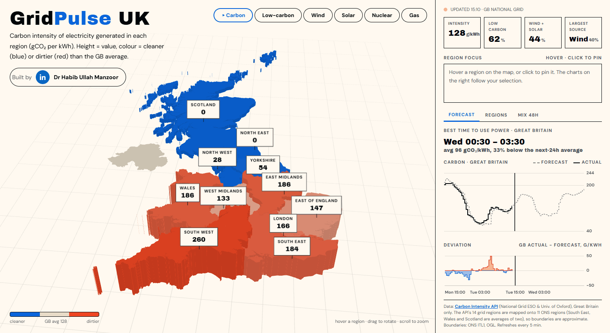

# GridPulse UK

**A live 3D map of Great Britain's electricity grid.** See how clean the power is in each region right now, what is generating it, and the best time to use it.

**[Live demo](https://habibullahmanzoor.github.io/gridpulse-uk/)** · Built by [Dr Habib Ullah Manzoor](https://www.linkedin.com/in/habib-ullah-manzoor-phd-smieee-miet-19198994/)



## What it does

- **Extruded 3D map** of 11 UK regions. Height shows the selected metric, colour shows whether a region is cleaner (blue) or dirtier (red) than the national average.
- **Six metric tabs:** carbon intensity, low-carbon share, wind, solar, nuclear and gas. Use the arrow keys to move between them. A link like `#wind` opens a tab directly.
- **Hover to focus, click to pin.** The hovered region rises and the rest sink. The charts in the side panel follow your selection: region against national trend, deviation from the national figure, a region-specific "best time to use power", and the 48-hour generation mix.
- **Live data**, refreshed every 5 minutes in the browser.

## How it is built

| Part | Choice | Why |
|---|---|---|
| Hosting | Static site on GitHub Pages | No server to run or pay for |
| 3D map | [deck.gl](https://deck.gl) `GeoJsonLayer` with extrusion and lighting | Real WebGL geometry from boundary data, no map tiles needed |
| Charts | Chart.js, updated in place | Smooth updates when the selection changes |
| Map labels | HTML overlays projected from map coordinates | Crisp text that tracks the 3D heights |
| Data | [Carbon Intensity API](https://carbonintensity.org.uk) | Free, CORS-enabled, no API key |
| Boundaries | ONS ITL1 regions, simplified to about 250 KB | Fast to load |
| History | `scripts/snapshot.py` (standard library only) | Collects hourly snapshots of the grid to analyse and forecast from |

No build step and no dependencies to install: `index.html` plus one boundary file.

## Design decisions worth knowing about

- **Region mapping.** The API reports 14 grid regions, but official boundaries come as 12 ITL1 regions. South East, Wales and Scotland are each an average of two API regions. This is approximate, and the page says so. Northern Ireland is not covered by the data and is greyed out.
- **Colour means the same thing on every tab.** Blue is always "cleaner", so more wind shows blue and more gas shows red. This avoids a legend that changes meaning per tab.
- **Flat, print-style look.** Cream paper, ink text and one blue accent, with sharp corners and no shadows. The 3D is the only depth in the page.

## Run it locally

```bash
python -m http.server 8000
# open http://localhost:8000
```

(The map data is loaded with `fetch`, so open it through a server rather than double-clicking the file.)

## Data collection

`scripts/snapshot.py` appends one record (national and per-region intensity and fuel mix) to `data/YYYY-MM.jsonl`. It uses only the Python standard library and each record is about 2.4 KB. Run it with `python scripts/snapshot.py`. A scheduled GitHub Action to run it hourly is the next step.

## Roadmap

- Hourly snapshot GitHub Action, then a trends page built from the collected history
- Forecast-accuracy comparison: a simple model against the API's own forecast
- A "when should I charge my EV" planner per region

## Data and licences

- Carbon intensity and generation data: [Carbon Intensity API](https://carbonintensity.org.uk), National Grid ESO and University of Oxford (CC BY 4.0).
- Boundaries: Office for National Statistics, ITL1 regions, contains public sector information licensed under the Open Government Licence v3.0.
